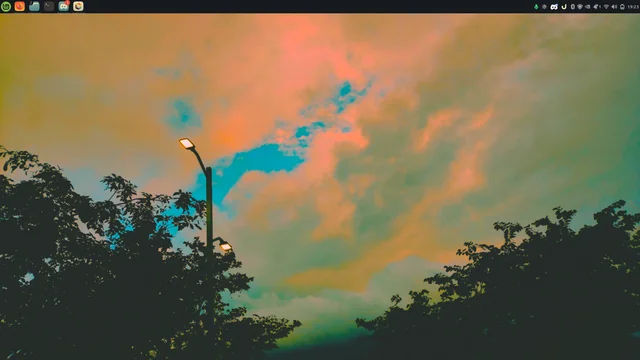
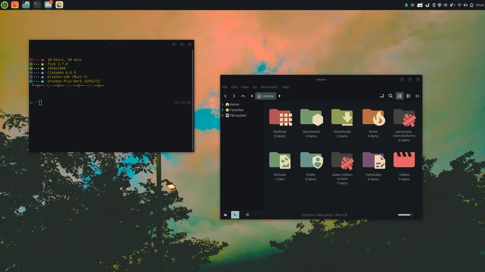

# 🌿🍂 mint-rice-byclunny

My **Linux Mint** rice, packed in one repo so you can replicate it step by step.
Gruvbox colors, a clean terminal and a custom look from top to bottom.

<p align="center">
  
  
</p>

> 🍵 **Just want the full rice without any manual steps?** Skip everything and jump to the [Final step](#-final-step--install-everything-automatically). One command installs and applies it all.

---

## 🏡 Repository structure

```
mint-rice-byclunny/
├── theme/      → Kripton v40 theme
├── icons/      → Gruvbox-Plus icon pack, my custom icons and the folder color script
├── neofetch/   → neofetch config (config.conf)
├── cursor/     → macOS cursor pack
├── ulauncher/  → Matcha-Dark-Azul theme for Ulauncher
├── others/     → download links and the fish shell commands
├── install.sh  → installs and applies the whole rice automatically
└── README.md
```

Each part is independent. You can follow every step or only the ones you like.

---

## 🧺 Before you start

Clone the repo and enter it:

```bash
sudo apt update && sudo apt install git -y
git clone https://github.com/oclunny/mint-rice-byclunny.git
cd mint-rice-byclunny
```

Create the folders used in the next steps (skip any that already exist):

```bash
mkdir -p ~/.themes ~/.icons ~/.config/neofetch
```

> Run every command from inside the `mint-rice-byclunny` folder.

---

## 🎨 Step 1 · Theme (Kripton v40)

🍂 Folder: `theme/`

1. Extract the theme into your themes folder:

```bash
tar -xf theme/Kripton-v40.tar.xz -C ~/.themes
```

2. Open **System Settings → Themes** and select **Kripton v40** for:
   - Window borders
   - Controls
   - Desktop

> Original theme: [gnome-look.org/p/1365372](https://www.gnome-look.org/p/1365372)

---

## 🧶 Step 2 · Icons (Gruvbox-Plus + custom)

🍂 Folder: `icons/`

This step has 3 parts: the icon pack, your folder color and (optionally) my custom icons.

### 🌰 2.1 Install the Gruvbox-Plus icon pack

```bash
tar -xf icons/gruvbox-plus-icon-pack.6.6.0.tar.gz -C ~/.icons
```

> Original icon pack: [gnome-look.org/p/1961046](https://www.gnome-look.org/p/1961046)

### 🍁 2.2 Choose your folder color

Make the script executable and run it with the color you want:

```bash
chmod +x icons/folders-color-chooser.sh
./icons/folders-color-chooser.sh -c grey
```

Available colors:

`black` `blue` `caramel` `citron` `firebrick` `gold` `green` `grey` `highland` `jade` `lavender` `lime` `olive` `orange` `pistachio` `plasma` `pumpkin` `purple` `red` `rust` `sapphire` `tomato` `violet` `white` `yellow`

Other options:

| Command | What it does |
|---|---|
| `./icons/folders-color-chooser.sh -l` | List all colors |
| `./icons/folders-color-chooser.sh -C` | Reset to the default color (`plasma`) |
| `./icons/folders-color-chooser.sh -h` | Show help |

### 🧵 2.3 Add my custom icons (optional)

Copy everything inside `icons/icons-byclunny/` into the icon pack, replacing the existing icons:

```bash
cp -r icons/icons-byclunny/* ~/.icons/Gruvbox-Plus-Dark/places/scalable/
```

> When asked, choose **replace all**.
> The color script below only works with **Gruvbox-Plus-Dark**, so use that version.

### 🌷 2.4 Apply the icons

Open **System Settings → Themes → Icons** and select **Gruvbox-Plus-Dark**.

---

## ☕ Step 3 · Neofetch

🍂 Folder: `neofetch/`

> **PREVIEW IMAGE HERE** (screenshot of neofetch)

1. Install neofetch:

```bash
sudo apt install neofetch -y
```

2. Copy the config:

```bash
cp neofetch/config.conf ~/.config/neofetch/config.conf
```

3. Run it:

```bash
neofetch
```

---

## 🐟 Step 4 · Fish shell + oh-my-fish (neofetch on startup)

🍂 Folder: `others/` (see the `fish commands` file)

1. Install fish:

```bash
sudo apt install fish -y
```

2. Install oh-my-fish:

```bash
curl https://raw.githubusercontent.com/oh-my-fish/oh-my-fish/master/bin/install | fish
```

3. Make fish your default shell:

```bash
chsh -s /usr/bin/fish
```

4. Run neofetch every time you open a terminal. Open fish and run:

```fish
function fish_greeting
    neofetch
end

funcsave fish_greeting
```

5. Log out and back in so the default shell change applies.

---

## 🧸 Step 5 · Cursor (macOS)

🍂 Folder: `cursor/`

1. Extract the cursor pack into your icons folder (it contains two cursors: `macOS` and `macOS-White`):

```bash
tar -xf cursor/macOS.tar.xz -C ~/.icons
```

2. Open **System Settings → Themes → Mouse Pointer** and select **macOS** (black) or **macOS-White**.

> Original cursor pack: [gnome-look.org/p/1408466](https://www.gnome-look.org/p/1408466)

---

## 🌙 Step 6 · Ulauncher + theme

🍂 Folder: `ulauncher/`

1. Install Ulauncher:

```bash
sudo add-apt-repository universe -y
sudo add-apt-repository ppa:agornostal/ulauncher -y
sudo apt update
sudo apt install ulauncher -y
```

2. Extract my theme (Matcha-Dark-Azul) into the Ulauncher themes folder:

```bash
mkdir -p ~/.config/ulauncher/user-themes
tar -xf ulauncher/Matcha-Dark-Azul-ulauncher.tar.gz -C ~/.config/ulauncher/user-themes
```

3. Start Ulauncher, open its **Preferences** (the gear icon, or `Ctrl + ,`), go to **Appearance** and select **Matcha-Dark-Azul**.

> Original theme: [DaveHigs/Matcha-Dark-Azul-ulauncher](https://github.com/DaveHigs/Matcha-Dark-Azul-ulauncher)
> More Ulauncher themes: [gist](https://gist.github.com/gornostal/02a232e6e560da7946c053555ced6cce)

---

<<<<<<< HEAD
## 🍵 Final step · Install everything automatically
=======
>>>>>>> 159d98db41d73f5a33fde800bf2fe9c28178fa49

Don't want to do it step by step? This one command clones the repo and installs and applies the whole rice:

```bash
sudo apt update && sudo apt install -y git && git clone https://github.com/oclunny/mint-rice-byclunny.git && cd mint-rice-byclunny && chmod +x install.sh && ./install.sh
```

What it does:

1. Installs the dependencies (git, curl, neofetch, fish...)
2. Installs and applies the **Kripton v40** theme
3. Installs **Gruvbox-Plus-Dark**, sets the folder color to **grey** and pastes my custom icons on top
4. Copies my neofetch config
5. Installs fish + oh-my-fish, makes fish your default shell and runs neofetch on startup
6. Installs and applies the **macOS** cursor
7. Installs Ulauncher, applies the **Matcha-Dark-Azul** theme and starts it with the system

When it finishes, **log out and log back in** so everything applies.

> Want another folder color? Open `install.sh`, change `FOLDER_COLOR="grey"` at the top and run it again.
> The script is made for **Linux Mint Cinnamon**. On other editions it installs everything but you have to select the theme, icons and cursor manually.

---

## 🧡 Credits

- Kripton theme: [gnome-look.org/p/1365372](https://www.gnome-look.org/p/1365372)
- Gruvbox-Plus icon pack: [gnome-look.org/p/1961046](https://www.gnome-look.org/p/1961046)
- macOS cursor pack: [gnome-look.org/p/1408466](https://www.gnome-look.org/p/1408466)
- Matcha-Dark-Azul Ulauncher theme: [DaveHigs](https://github.com/DaveHigs/Matcha-Dark-Azul-ulauncher)
- Custom icons, neofetch config and guide: [oclunny](https://github.com/oclunny)
